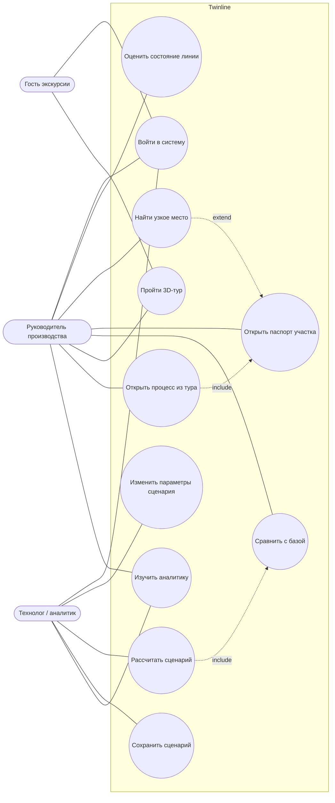

# 1. Требования к системе Twinline

> Источник требований — техническое задание хакатона «Цифровой двойник предприятия и 3D-туры по производству» (12 слайдов). Ссылки вида [С8] указывают номер слайда.

## 1.1. Введение

**Цель.** Прототип цифрового решения, которое моделирует процессы предприятия, проверяет сценарии изменений до внедрения и проводит интерактивные экскурсии по производству [С3].

**Гипотеза.** Связка «процесс → сценарий → метрики → 3D-тур» делает визуальный рассказ о предприятии проверяемым: каждый объект тура привязан к этапу процесса и рассчитанной метрике [С5].

**Предметная область.** Вымышленный «Демо-завод корпусных деталей», линия выпуска корпусов редукторов КР-160. Шесть участков: приёмка сырья → подготовка материалов → механическая обработка → контроль качества → упаковка → отгрузка. Две смены по 8 часов.

**Заинтересованные стороны.**

| Роль | Задача | Раздел системы |
|---|---|---|
| Руководитель производства | Видеть картину целиком, находить узкие места, проверять гипотезы и сравнивать варианты [С4] | Обзор, двойник, сценарии, аналитика, тур |
| Технолог / аналитик | Менять параметры участков, оценивать влияние изменений | Сценарии, аналитика |
| Внешняя аудитория (абитуриенты, партнёры, клиенты, новые сотрудники) | Виртуальный доступ к производству, понятная история, проверяемые кейсы [С4] | 3D-тур (роль «Гость экскурсии») |

## 1.2. Бизнес-требования

| ID | Требование | Источник |
|---|---|---|
| БТ-1 | Единая модель процессов, ресурсов и метрик предприятия | [С10-01] |
| БТ-2 | Поиск узких мест и оценка влияния изменений до внедрения | [С10-02], [С8] |
| БТ-3 | Сравнение альтернативных сценариев по показателям | [С10-03] |
| БТ-4 | Дашборды и диаграммы для руководства | [С10-04] |
| БТ-5 | Интерактивные 3D-туры для презентации и обучения | [С10-05] |
| БТ-6 | Связь тура с процессом, кейсом и реальной метрикой | [С10-06], [С9-03] |
| БТ-7 | Прозрачность эффективности процессов и результатов | [С10-07] |

## 1.3. Функциональные требования

| ID | Требование | Где реализовано |
|---|---|---|
| ФТ-01 | Регистрация и вход по логину и паролю, защищённые маршруты, ролевой доступ (руководитель / гость), смена пароля | `/login`, `server/`, `RequireAuth` |
| ФТ-01а | Управление пользователями: смена роли, удаление | `/users` |
| ФТ-02 | Обзор: состояние линии, производительность, время цикла, выпуск, загрузка оборудования, операционные затраты, число узких мест, динамика, состояние участков, последние расчёты | `/` |
| ФТ-03 | Модель процесса как граф этапов; для узла заданы время, ресурс, стоимость [С8-01] | `/twin`, `data/demo/enterprise.ts` |
| ФТ-04 | Интерактивная мнемосхема: выбор этапа открывает паспорт (время, ресурсы, производительность, загрузка, стоимость операции, статус) | `/twin?stage=` |
| ФТ-05 | Визуальные связи этапов, интенсивность потока, очереди, обозначение перегрузки и узких мест | `ProcessFlow`, `FlowEdge` |
| ФТ-06 | Прогон процесса при выбранной нагрузке и ресурсах: задержки, перегрузка, простои [С8-02] | `domain/simulation/engine.ts` |
| ФТ-07 | Изменение параметров: ресурсы, скорость обработки, нагрузка, время операций, стоимость ресурсов | `/scenarios` |
| ФТ-08 | Пересчёт показателей по кнопке «Рассчитать», индикация устаревших результатов | `ScenarioWorkbench` |
| ФТ-09 | Сравнение «база vs сценарий»: время цикла, выпуск, загрузка, стоимость; таблица, график, индикаторы улучшения/ухудшения, текстовые выводы [С8-03] | `ResultsPanel` |
| ФТ-10 | Сохранение, переименование, дублирование, удаление сценариев, переключение между ними | `store/scenarios.ts` |
| ФТ-11 | Аналитика: производительность по этапам, загрузка, время операций, узкие места, сравнение сценариев | `/analytics` |
| ФТ-12 | Анализ чувствительности «±1 ресурс» по каждому участку (реальный перерасчёт) | `domain/simulation/sensitivity.ts` |
| ФТ-13 | 3D-сцена цеха в браузере: вращение, масштаб, сдвиг камеры [С9-01] | `/tour` |
| ФТ-14 | Точки интереса с описанием, показателями, кейсами лучших практик [С9-02] | `PoiPanel` |
| ФТ-15 | Маршрут экскурсии: переход между участками по порядку, «назад/далее» [С9-01] | режим «Маршрут» |
| ФТ-16 | Переход из тура к процессу, метрике и сценарию; обратный переход из двойника в тур [С9-03] | ссылки `/twin?stage=`, `/analytics?stage=`, `/tour?poi=` |
| ФТ-17 | Отражение сценария в туре: число станков, сигнальные лампы, скорость потока изделий | `Zones`, `FlowItems` |
| ФТ-18 | Пометка демонстрационных данных во всех разделах | бейдж «Демо-данные», подписи кейсов |

## 1.4. Нефункциональные требования

| ID | Требование | Решение |
|---|---|---|
| НФТ-01 | Работа на ПК, планшете, телефоне [С12] | Боковое меню ≥ 1280 px, иконочная рейка 768–1279 px, нижняя панель < 768 px; списочный вид мнемосхемы; нижний лист деталей |
| НФТ-02 | 3D в браузере на WebGL/Three.js без тяжёлых движков [С12] | React Three Fiber, низкополигональная геометрия, общие материалы, instancing |
| НФТ-03 | Производительность 3D на мобильных | DPR ≤ 1,25, тени выключены, `PerformanceMonitor` снижает DPR, ленивая загрузка чанка |
| НФТ-04 | Базовая авторизация [С12] | Серверная: хеши паролей scrypt, сессии в httpOnly-cookie, проверка ролей на сервере, защита от перебора и CSRF (см. §2.9) |
| НФТ-05 | 152-ФЗ [С12] | Минимум данных: только логин, хеш пароля, роль и дата регистрации; без ФИО и контактов; база — на сервере предприятия |
| НФТ-06 | Без интеграций с ERP, MES, 1С [С12] | Данные — в `src/data/demo`, интеграции не имитируются |
| НФТ-07 | Детерминированность расчёта | Чистые функции без случайных чисел; одинаковые параметры → одинаковый результат (покрыто тестом) |
| НФТ-08 | Время расчёта сценария | < 1 мс на линию из 6 участков (замеряется и показывается пользователю) |
| НФТ-09 | Доступность | Семантические ориентиры, «перейти к содержимому», видимый фокус, статусы иконкой и текстом, табличное представление каждого графика, `<dialog>` для подтверждений, `prefers-reduced-motion` |
| НФТ-10 | Устойчивость | Граница ошибок на каждый раздел; запасной 2D-план без WebGL; проверка и восстановление повреждённого localStorage |
| НФТ-11 | Сопровождаемость | TypeScript strict, разделение data / domain / store / features, демо-данные в одном каталоге |

## 1.5. Ограничения

- Интеграций с внешними системами ERP, MES и 1С нет [С12].
- Данные синтетические, генерируются в коде и помечены как демонстрационные [С12].
- Модель линии — аналитическая (теория очередей), а не дискретно-событийная симуляция: это осознанный выбор ради мгновенного, объяснимого и детерминированного расчёта.
- Демо-учётки `manager / demo` и `guest / tour` создаются для показа и отключаются в эксплуатации (`TWINLINE_SEED_DEMO=0`).

## 1.6. Варианты использования

## 1.7. Критерии приёмки

| № | Критерий | Проверка |
|---|---|---|
| КП-1 | Показатели обзора совпадают с расчётом модели базового сценария | Тест `engine.test.ts`, ТК-03 |
| КП-2 | Узкое место определяется автоматически и отображается на обзоре, мнемосхеме, в аналитике и 3D-туре одинаково | ТК-04, ТК-11 |
| КП-3 | Изменение параметров предсказуемо меняет метрики (больше ресурсов → меньше загрузка и время цикла; больше нагрузка → выше загрузка) | Тесты монотонности, ТК-06 |
| КП-4 | Сценарий сохраняется, переживает перезагрузку страницы, переключается и удаляется с подтверждением | ТК-07, ТК-08 |
| КП-5 | Сравнение «до/после» показывает 4 ключевые метрики ТЗ и направление изменения | ТК-06 |
| КП-6 | Из любой точки интереса 3D-тура можно перейти к процессу и метрике, а из паспорта участка — в тур | ТК-11, ТК-12 |
| КП-7 | Интерфейс работает на ширине 375, 768 и 1440 px | ТК-15 |
| КП-8 | Гость видит только тур, без финансовых показателей; права проверяются сервером | ТК-02, ТК-22 |
| КП-9 | Регистрация, вход, выход и смена роли работают через сервер; пароли хранятся только в виде хеша | Автотесты `server/app.test.ts`, ТК-22–ТК-24 |
