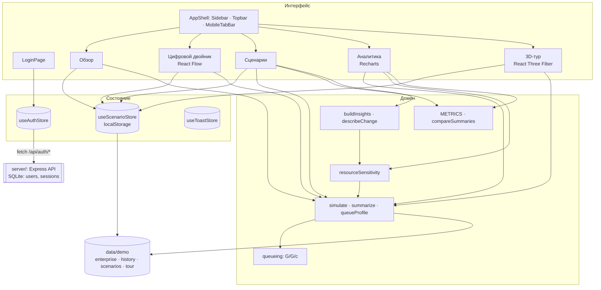
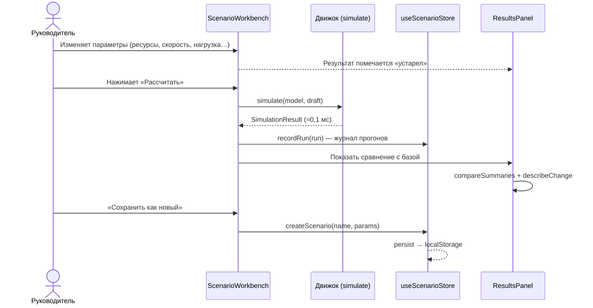
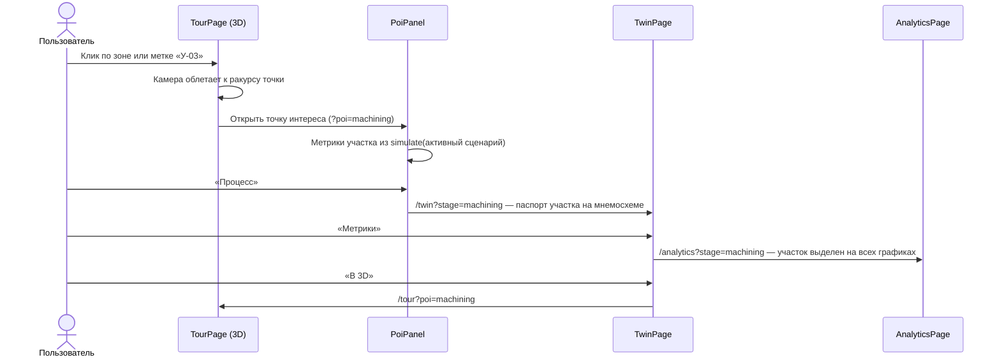
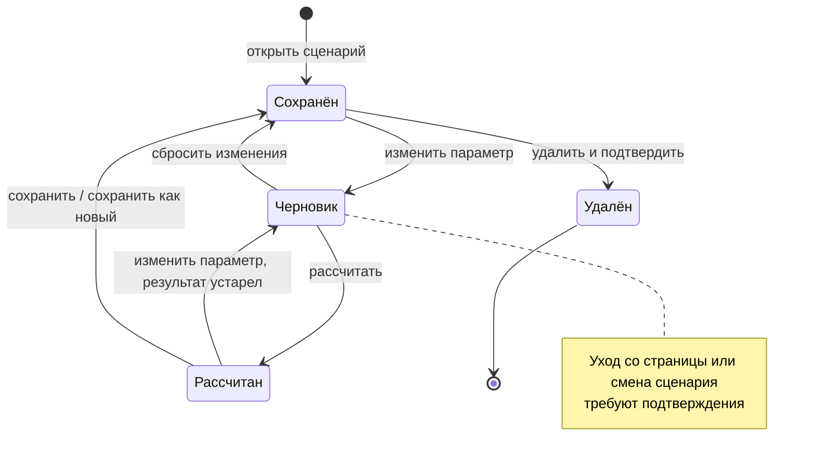
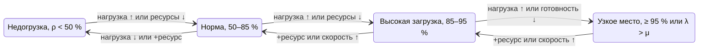
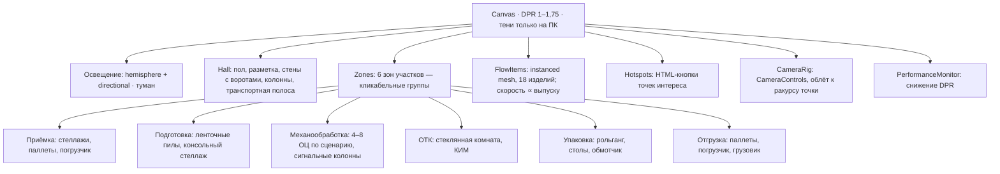

# 2. Архитектура

## 2.1. Обзор

Twinline — одностраничное веб-приложение (SPA) и небольшой сервер авторизации. Все расчёты выполняются в браузере детерминированным движком; данные предприятия — синтетические и лежат в одном каталоге, чтобы их можно было заменить реальными.

| Слой | Каталог | Ответственность |
|---|---|---|
| Данные | `src/data/demo` | Предприятие, участки, базовые параметры, история, пресеты сценариев, точки интереса, демо-учётки |
| Домен | `src/domain` | Типы, движок расчёта, метрики и сравнение, статусы, выводы и рекомендации, форматирование |
| Состояние | `src/store` | Zustand: текущий пользователь (из ответа сервера), сценарии и журнал прогонов (localStorage), уведомления |
| Сервер | `server/` | Node.js + Express: регистрация, вход, сессии, роли, управление пользователями; SQLite (встроен в Node.js) |
| Интерфейс | `src/components`, `src/features` | Дизайн-система, оболочка, разделы: обзор, двойник, сценарии, аналитика, 3D-тур, вход |

Стек: React 19 + TypeScript, Vite, Tailwind CSS 4, React Router 7 (data router), React Flow 12, Recharts 3, Three.js + React Three Fiber + drei, Zustand, lucide-react, Vitest.

## 2.2. Компоненты



## 2.3. Интерфейсы домена

```ts
simulate(model: LineModel, params: ScenarioParams): SimulationResult   // расчёт линии
summarize(result): KpiSummary                                          // сводка для журнала и сравнения
queueProfile(result, stepHours): Array<{ hour; [stageId]: number }>    // очереди в течение суток
resourceSensitivity(model, params): SensitivityRow[]                   // ±1 ресурс по каждому участку
compareSummaries(base, alt, keys): MetricDelta[]                       // дельты с оценкой «лучше/хуже»
buildInsights(model, params, result): StageInsight[]                   // находки и рекомендации
describeChange(model, base, alt): Conclusion[]                         // текстовые выводы сравнения
```

Маршруты (состояние выбора хранится в URL, поэтому любое состояние можно открыть ссылкой):

| Путь | Параметры | Роль |
|---|---|---|
| `/login` | — | все |
| `/` | — | руководитель |
| `/twin` | `stage` — выбранный участок | руководитель |
| `/scenarios` | `id` — сценарий, `focus` — участок, `delta` — предложение ±1 ресурс | руководитель |
| `/analytics` | `scenario`, `stage` — фильтры | руководитель |
| `/tour` | `poi` — точка интереса или id участка | руководитель, гость |

## 2.4. Метод расчёта

Для каждого участка *i* с параметрами: ресурсы *c*, норма времени *t*, скорость *s*, готовность оборудования *A*:

- эффективное время операции `tₑ = t / (s · A)`;
- мощность `μ = c · 60 / tₑ` (шт/ч);
- поток идёт по маршруту: участок обрабатывает `min(λᵢ, μᵢ)`, на выход передаётся `обработано · выход годных`;
- загрузка `ρ = обработано / μ`, доля простоя `1 − ρ`;
- ожидание — аппроксимация Кингмана–Сакасегавы для G/G/c:
  `Wq = (ca² + cs²)/2 · ρ^(√(2(c+1)) − 1) / (c(1 − ρ)) · tₑ`,
  вариация выходящего потока передаётся следующему участку: `cd² = 1 + (1 − ρ²)(ca² − 1) + ρ²(cs² − 1)/√c`;
- при перегрузке (`λ > μ`) задел растёт со скоростью `λ − μ`, средняя дополнительная очередь за сутки `(λ − μ) · H / 2`;
- время цикла `CT = Σ(Wq + tₑ + транспорт)`; НЗП по закону Литтла `L = λ · W`;
- затраты: ресурсы `c · ставка` оплачиваются всё рабочее время, переменные — за обработанные изделия, материал — за запущенные; себестоимость = (операционные + материал) / выпуск годных.

Статусы участка: ρ ≥ 95 % или перегрузка — узкое место; 85–95 % — высокая загрузка (риск); < 50 % — недогрузка (простой); иначе норма. Пороги — в `src/config/app.ts`.

## 2.5. Последовательность: расчёт и сравнение сценария



## 2.6. Последовательность: тур → процесс → метрика



## 2.7. Состояния

Жизненный цикл сценария в редакторе:



Статус участка (вычисляется после каждого расчёта):



## 2.8. Архитектура 3D-сцены



Связь со сценарием: число обрабатывающих центров берётся из параметров активного сценария, цвет сигнальных колонн — из статуса участка, скорость потока изделий — из выпуска. Без WebGL тур переключается на 2D-план цеха с теми же точками интереса.

## 2.9. Авторизация и персональные данные

Авторизация серверная (`server/`): Node.js + Express, база SQLite, встроенная в Node.js (`node:sqlite`).

| Аспект | Решение |
|---|---|
| Регистрация | Открытая: логин (3–32 символа `a-z 0-9 . _ -`) и пароль (≥ 8 символов, буквы и цифры, без логина). Новый пользователь получает роль «Гость экскурсии» |
| Роли | `manager` — все разделы и управление пользователями; `guest` — только 3D-тур без финансовых показателей. Роль выдаёт руководитель на странице «Пользователи» |
| Хранение паролей | scrypt (N = 16384, r = 8, p = 1), уникальная соль; сравнение за постоянное время |
| Сессия | Случайный токен 256 бит в cookie `twinline_session`: `HttpOnly`, `SameSite=Lax`, `Secure` при `COOKIE_SECURE=1`; срок 12 ч. В базе — только SHA-256 токена |
| Проверка прав | Роль читается из базы на каждом запросе — смена роли и удаление действуют сразу. Фронтенд скрывает недоступные разделы, но решение принимает сервер |
| CSRF | Изменяющие запросы принимаются только как JSON и только с того же Origin; cookie `SameSite=Lax` |
| Перебор паролей | 5 неудачных попыток на пару «IP + логин» — блокировка на 15 мин; регистрация — не более 10 в час с одного IP; одинаковое время ответа для существующих и несуществующих логинов |
| Защита от блокировки | Нельзя изменить свою роль, удалить себя и последнего руководителя |
| Смена пароля | Требует текущий пароль; остальные сессии пользователя завершаются |

API:

| Метод | Путь | Доступ | Назначение |
|---|---|---|---|
| POST | `/api/auth/register` | все | Регистрация и вход |
| POST | `/api/auth/login` | все | Вход |
| POST | `/api/auth/logout` | все | Выход (сессия удаляется на сервере) |
| GET | `/api/auth/me` | вошедшие | Текущий пользователь |
| POST | `/api/auth/password` | вошедшие | Смена пароля |
| GET | `/api/users` | руководитель | Список пользователей |
| PATCH | `/api/users/:id` | руководитель | Смена роли |
| DELETE | `/api/users/:id` | руководитель | Удаление |

**152-ФЗ.** Собираются только логин и пароль (хранится хеш), роль и дата регистрации — без ФИО, e-mail, телефона. База лежит на сервере предприятия (`server/data/twinline.db`). Для эксплуатации: HTTPS (`COOKIE_SECURE=1`), размещение сервера в РФ, политика обработки данных; при необходимости — корпоративный вход (OIDC / LDAP) с той же ролевой моделью.

**Демо-учётки** `manager / demo` и `guest / tour` создаются при первом запуске для показа жюри; они не проходят парольную политику и отключаются переменной `TWINLINE_SEED_DEMO=0`.

## 2.10. Развёртывание

Разработка: `npm run dev` запускает API (порт 3001) и Vite (порт 5173), который проксирует `/api` на API. Эксплуатация: `npm run build`, затем `npm start` — один процесс Node.js раздаёт и API, и собранный фронтенд из `dist/` (переменные `TWINLINE_PORT`, `TWINLINE_HOST`, `TWINLINE_DB`, `COOKIE_SECURE`, `TWINLINE_SEED_DEMO`).
