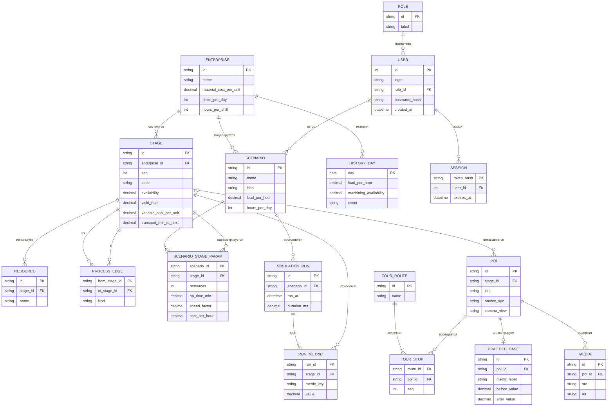
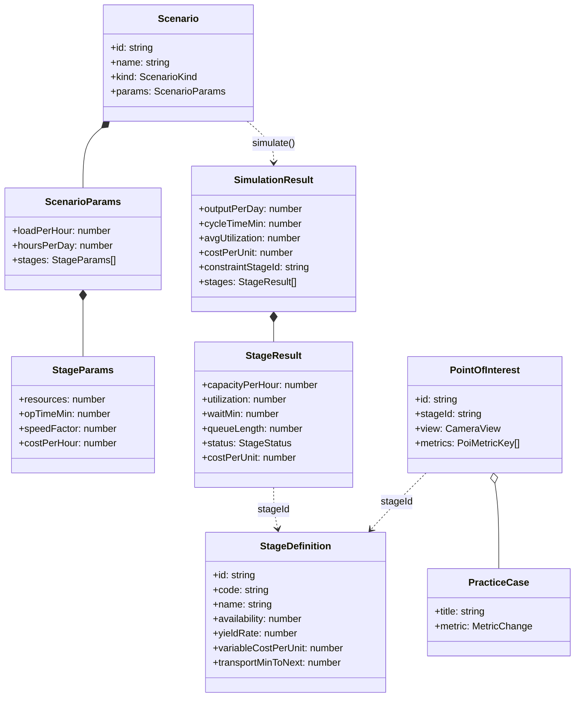

# 3. Модель данных

Прототип хранит справочные данные в коде (`src/data/demo`), а пользовательские сценарии и журнал прогонов — в `localStorage`. Ниже — целевая модель БД, на которую ложатся текущие TypeScript-типы (`src/domain/types.ts`). Названия таблиц и полей совпадают с именами в коде.

## 3.1. Сущности и атрибуты

**ENTERPRISE — предприятие**

| Поле | Тип | Описание |
|---|---|---|
| id | string, PK | Идентификатор |
| name, short_name | string | Название |
| site | string | Цех / линия |
| product_name, product_unit | string | Изделие и единица учёта |
| material_cost_per_unit | decimal | Стоимость заготовки, ₽ |
| shifts_per_day, hours_per_shift | int | Режим работы |

**STAGE — участок (этап процесса)**

| Поле | Тип | Описание |
|---|---|---|
| id | string, PK | `receiving`, `preparation`, `machining`… |
| enterprise_id | FK → ENTERPRISE | |
| seq | int | Порядок в маршруте изделия |
| code | string | Код на мнемосхеме (У-01…) |
| name, short_name, description, area | string | Паспорт участка |
| availability | decimal 0..1 | Готовность оборудования |
| yield_rate | decimal 0..1 | Доля годных на выходе |
| variable_cost_per_unit | decimal | Переменные затраты, ₽/шт |
| transport_min_to_next | decimal | Транспорт до следующего участка, мин |
| service_cv2 | decimal | Квадрат коэффициента вариации обработки |

**RESOURCE — единица оборудования / персонала**

| Поле | Тип | Описание |
|---|---|---|
| id | string, PK | |
| stage_id | FK → STAGE | |
| name | string | «ОЦ-3», «КИМ» |
| kind | string | Тип ресурса |

**PROCESS_EDGE — связь этапов**

| Поле | Тип | Описание |
|---|---|---|
| from_stage_id, to_stage_id | FK → STAGE | Направление потока |
| kind | enum | `flow` / `scrap` |

**SCENARIO — сценарий**

| Поле | Тип | Описание |
|---|---|---|
| id | string, PK | |
| name, description | string | |
| kind | enum | `baseline` / `preset` / `user` |
| load_per_hour | decimal | Производственная нагрузка, шт/ч |
| hours_per_day | int | Рабочих часов в сутки |
| created_at, updated_at | timestamp | |

**SCENARIO_STAGE_PARAM — параметры участка в сценарии**

| Поле | Тип | Описание |
|---|---|---|
| scenario_id | FK → SCENARIO, PK | |
| stage_id | FK → STAGE, PK | |
| resources | int | Количество ресурсов |
| op_time_min | decimal | Норма времени операции |
| speed_factor | decimal | Скорость относительно нормы |
| cost_per_hour | decimal | Стоимость часа ресурса |

**SIMULATION_RUN — прогон сценария**

| Поле | Тип | Описание |
|---|---|---|
| id | string, PK | |
| scenario_id | FK → SCENARIO | |
| ran_at | timestamp | |
| duration_ms | decimal | Время расчёта |

**RUN_METRIC — значение метрики прогона**

| Поле | Тип | Описание |
|---|---|---|
| run_id | FK → SIMULATION_RUN | |
| stage_id | FK → STAGE, null | null — показатель линии |
| metric_key | string | `cycleTimeMin`, `outputPerDay`, `utilization`… |
| value | decimal | |

**HISTORY_DAY — входные данные истории**: дата, нагрузка, готовность оборудования по участкам, событие. Показатели истории рассчитываются движком.

**TOUR_ROUTE / TOUR_STOP / POI / PRACTICE_CASE / MEDIA** — объекты 3D-тура: маршрут, порядок остановок, точка интереса (якорь, ракурс камеры, связанный участок, список метрик), кейс лучшей практики (метрика «до/после»), медиа (изображения/видео, необязательно).

**USERS** (реализовано, `server/db.ts`): `id`, `login` (уникальный), `role` (`manager` / `guest`), `password_hash` (scrypt), `created_at`.

**SESSIONS** (реализовано): `token_hash` (SHA-256 токена, PK), `user_id` → USERS (каскадное удаление), `created_at`, `expires_at`.

ФИО, e-mail и телефоны не хранятся.

## 3.2. ER-диаграмма



## 3.3. UML-диаграмма классов (домен)



## 3.4. Наборы данных для обмена

Сценарий (формат хранения в `localStorage`, ключ `twinline.scenarios`, версия 1):

```json
{
  "id": "sc-4f1a2b3c",
  "name": "Сценарий 1",
  "description": "Пятый ОЦ и ускорение КИМ",
  "kind": "user",
  "params": {
    "loadPerHour": 26.5,
    "hoursPerDay": 16,
    "stages": {
      "machining": { "resources": 5, "opTimeMin": 9, "speedFactor": 1, "costPerHour": 4300 },
      "inspection": { "resources": 2, "opTimeMin": 4.5, "speedFactor": 1.2, "costPerHour": 2600 }
    }
  },
  "createdAt": "2026-11-08T10:00:00.000Z",
  "updatedAt": "2026-11-08T10:05:00.000Z"
}
```

При загрузке хранилище проверяется: некорректные записи отбрасываются, базовый сценарий всегда берётся из кода, пользователь получает уведомление о восстановлении.

## 3.5. Как заменить демо-данные реальными

1. `src/data/demo/enterprise.ts` — предприятие, участки (`STAGES`) и текущие параметры (`BASELINE_PARAMS`).
2. `src/data/demo/history.ts` — фактические ряды нагрузки и готовности оборудования (показатели посчитает движок) или готовые фактические метрики.
3. `src/data/demo/tour.ts` — планировка зон, точки интереса, ракурсы, кейсы, медиа.
4. Типы в `src/domain/types.ts` — контракт; компоненты интерфейса правок не требуют.
