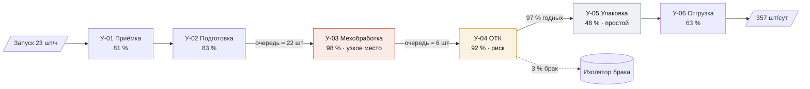
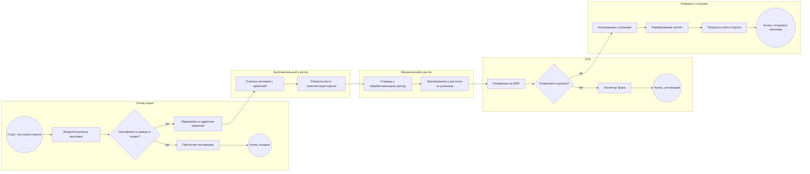
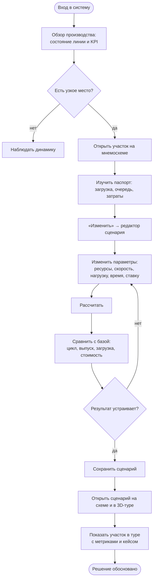

# 4. Модели процессов

## 4.1. Системный анализ: проблема участка

Линия выпускает корпуса редукторов; запуск — 23 заготовки в час, две смены по 8 часов. По модели (базовый режим):

| Участок | Ресурсы | Загрузка | Ожидание | Статус |
|---|---|---|---|---|
| У-01 Приёмка сырья | 2 приёмщика | 81 % | 4 мин | норма |
| У-02 Подготовка материалов | 2 станка | 83 % | 5 мин | норма |
| **У-03 Механическая обработка** | 4 ОЦ | **98 %** | **58 мин** | **узкое место** |
| У-04 Контроль качества | 2 поста | 92 % | 15 мин | риск |
| У-05 Упаковка | 2 поста | 48 % | < 1 мин | недогрузка |
| У-06 Отгрузка | 1 бригада | 63 % | 2 мин | норма |

Время цикла — 2 ч 16 мин, из них ожидание в очередях ≈ 62 %. Любое снижение готовности обрабатывающих центров приводит к недовыпуску (в истории — 9 дней из 30, включая отказ шпинделя ОЦ-3). Руководству нужно понять, что даст пятый ОЦ, как изменится картина при новом контракте (+15 % нагрузки) и во что это обойдётся.

## 4.2. Мнемосхема участка

Мнемосхема реализована интерактивно в разделе «Цифровой двойник» (`/twin`): «змейка» из шести участков, вход «Запуск в производство», выход «Отгрузка заказчикам», ветка брака из ОТК. На рёбрах — интенсивность потока (шт/ч) и очередь перед следующим участком; цвет и толщина ребра отражают перегрузку получателя.

## 4.3. BPMN-подобная схема процесса

Дорожки соответствуют службам предприятия; шлюз на контроле качества разделяет годные изделия и брак.

## 4.4. Диаграмма действий: путь руководителя

## 4.5. Диаграмма последовательности и состояний

См. `02-architecture.md`: §2.5 (расчёт сценария), §2.6 (тур → процесс → метрика), §2.7 (жизненный цикл сценария и статусы участка).

## 4.6. Демонстрационные сценарии и результаты модели

| Сценарий | Выпуск, шт/сут | Время цикла | Ограничение | Себестоимость |
|---|---|---|---|---|
| Базовый режим | 357 | 2 ч 16 мин | У-03, 98 % | 5 556 ₽ |
| +1 обрабатывающий центр | 357 | 1 ч 20 мин | У-04, 92 % | 5 748 ₽ (+3,5 %) |
| Пиковая нагрузка +15 % | 364 при плане 411 | 4 ч 15 мин | У-03, 100 % (перегрузка) | 5 971 ₽ |
| Пик: ОЦ-5 и ускорение ОТК | 411 = план | 1 ч 28 мин | У-01, 93 % | 5 539 ₽ |

Вывод для защиты: пятый ОЦ при текущей нагрузке сокращает цикл, но не увеличивает выпуск и дорожает себестоимость; под новый контракт его нужно вводить вместе с ускорением ОТК и подготовки — тогда план выполняется, а себестоимость даже снижается за счёт объёма.
