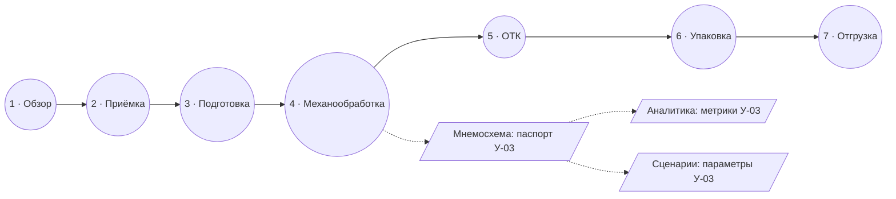

# 5. 3D-тур: архитектура сцены и карта точек интереса

## 5.1. Сцена

Цех 68 × 32 м показан «в разрезе»: снята кровля, передняя стена и передний ряд колонн. Поток изделий идёт слева направо — от ворот приёмки к отгрузочному доку. Ось X — вдоль потока, Z — поперёк цеха, Y — вверх; координаты в метрах (`src/data/demo/tour.ts`).

| Зона | Центр (x, z) | Размер | Объекты |
|---|---|---|---|
| У-01 Приёмка | −27,5; −1 | 12 × 26 | 2 стеллажа адресного хранения, стол входного контроля, паллеты, погрузчик, грузовик у ворот |
| У-02 Подготовка | −15; −1 | 10 × 26 | 2 ленточнопильных станка, консольный стеллаж, стол разметки |
| У-03 Механообработка | 0; −1 | 18 × 26 | 4–8 обрабатывающих центров (по сценарию), сигнальные колонны, инструментальный шкаф |
| У-04 ОТК | 14,5; −1 | 9 × 26 | Стеклянная термостатированная комната, КИМ, рабочее место контролёра |
| У-05 Упаковка | 23,5; −1 | 9 × 26 | Рольганг, 2 поста упаковки, обмотчик паллет, тара |
| У-06 Отгрузка | 31; −1 | 6 × 26 | Паллеты с готовой продукцией, погрузчик, грузовик у дока |

Транспортная полоса (z = 9) проходит через все зоны; по ней движутся изделия, меняющие вид по ходу процесса: литая заготовка → обработанный корпус (после У-03) → коробка (после У-05).

**Связь сцены с моделью.**

| Элемент сцены | Источник в модели |
|---|---|
| Количество обрабатывающих центров | `params.stages.machining.resources` активного сценария (новые отмечены акцентной полосой) |
| Цвет сигнальных колонн | `StageResult.status`: зелёный — норма, жёлтый — риск, красный — перегрузка |
| Кольцо вокруг номера метки | Тот же статус участка (для роли «руководитель») |
| Скорость изделий на полосе | `outputPerHour` сценария относительно базового режима |
| Карточка точки интереса | Метрики `StageResult` выбранного участка |

**Визуальный стиль.** Процедурное студийное окружение (RoomEnvironment, без загрузки файлов) даёт отражения на металле и эпоксидном полу; техническая сетка пола; стены из сэндвич-панелей с цоколем и ленточным остеклением; скруглённые корпуса станков с подсвеченной рабочей зоной и экраном пульта; условные фигуры операторов для масштаба; коды и названия участков, нанесённые на пол (текстура рисуется в браузере).

**Производительность.** Только простая геометрия (боксы и цилиндры), ≈ 25 общих материалов, изделия — одна `InstancedMesh`. На телефоне: DPR ≤ 1,25, без теней. `PerformanceMonitor` снижает DPR при падении FPS. Чанк Three.js загружается только при открытии тура. Без WebGL показывается 2D-план с теми же точками.

**Навигация.** `CameraControls`: вращение (ЛКМ / один палец), сдвиг (ПКМ / два пальца), масштаб (колесо / щипок); ограничения угла (камера не уходит под пол) и дистанции. При выборе точки — плавный облёт к ракурсу (отключается при `prefers-reduced-motion`). Кнопка «Общий вид» возвращает обзорный ракурс.

## 5.2. Карта точек интереса

| № | Точка (`poi`) | Участок | Метрики двойника в карточке | Кейс лучшей практики (демо) | Переходы |
|---|---|---|---|---|---|
| 1 | `overview` — Цех №1: линия корпусов | — | Выпуск за сутки, время цикла | — | — |
| 2 | `receiving` — Склад сырья и приёмка | У-01 | Статус, загрузка, производительность, ожидание, ресурсы | Адресное хранение: поиск партии 12 → 4 мин | Процесс, метрики, сценарий |
| 3 | `preparation` — Заготовительный участок | У-02 | Статус, загрузка, производительность, ожидание, стоимость операции | Режимы резания: время реза 4,7 → 4,0 мин | Процесс, метрики, сценарий |
| 4 | `machining` — Механический участок | У-03 | Статус, загрузка, мощность, производительность, ожидание, ресурсы, стоимость операции | SMED: переналадка 45 → 28 мин | Процесс, метрики, сценарий |
| 5 | `inspection` — Лаборатория ОТК | У-04 | Статус, загрузка, производительность, ожидание, стоимость операции | SPC: брак 4,1 → 3,0 % | Процесс, метрики, сценарий |
| 6 | `packaging` — Участок упаковки | У-05 | Статус, загрузка, производительность, ресурсы, стоимость операции | Стандартизированная тара: повреждения 0,8 → 0 % | Процесс, метрики, сценарий |
| 7 | `shipping` — Отгрузочный док | У-06 | Статус, загрузка, производительность, ресурсы | Окна отгрузки: простой транспорта 52 → 34 мин | Процесс, метрики, сценарий |

Финансовые показатели (стоимость операции) и переходы в двойник видны только роли «Руководитель». Гость видит рассказ, факты, операционные метрики и кейсы.

## 5.3. Маршрут экскурсии

«Маршрут изделия» — 7 остановок в порядке производственного потока (1 → 7). В режиме «Маршрут» карточка содержит «Назад / Далее», камера облетает к следующей остановке. Маршрут задан данными (`TOUR_ROUTE.stops`) — можно добавить, например, короткий маршрут для абитуриентов.

## 5.4. Медиа

Модель точки интереса поддерживает поле `media` (изображения или видео с подписью). В демо-данных медиа не заданы: организаторы не предоставили фото цеха, а генерировать «фотографии» несуществующего завода мы сознательно не стали.
